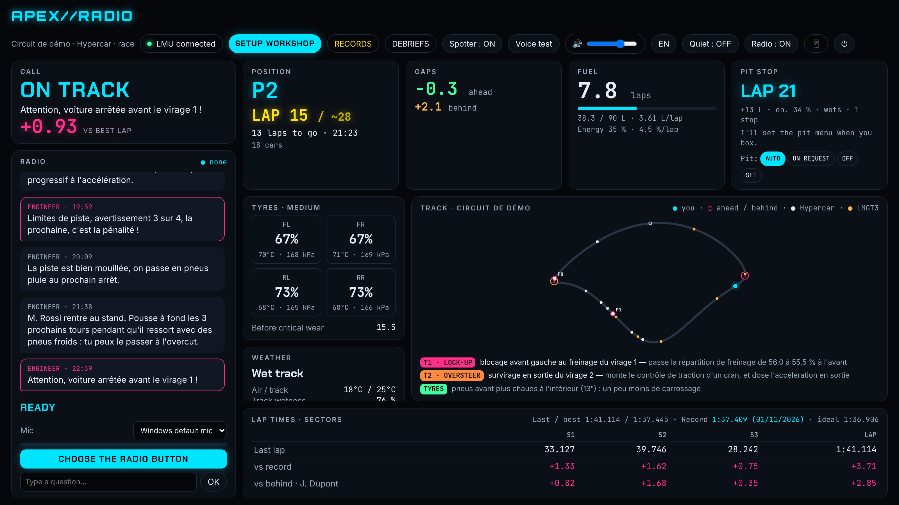
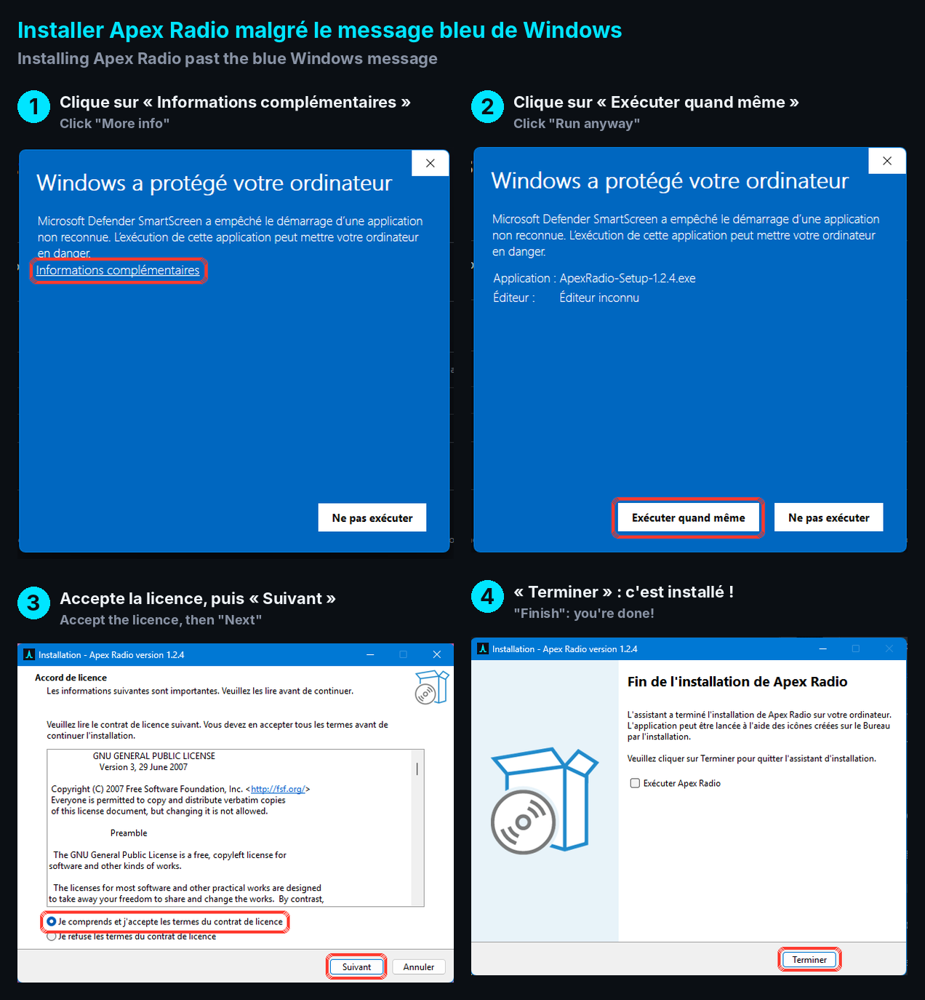

# APEX//RADIO

**A free voice race engineer for Le Mans Ultimate** · *Un ingénieur de course vocal gratuit pour Le Mans Ultimate*

🇬🇧 [English](#english) · 🇫🇷 [Français](#français)

**⬇️ [Download / Télécharger](https://github.com/ApexRadio/apex-radio/releases/latest)** · 💬 [Discord](https://discord.gg/wpqNBpMaa) · ❤️ [Patreon](https://www.patreon.com/lolotuner)

---

## English

Apex Radio listens to Le Mans Ultimate in real time and talks to you on the radio, like a real race engineer.
Push a button on your wheel, ask a question, get an answer. Everything runs locally on your PC: no subscription,
no account, no internet needed once installed.

### What it does
- **Strategy**: fuel and energy per lap, range, pit lap, how much fuel to add, tyre change or not.
- **Pit menu**: sets the LMU pit menu for you when you box (fuel, tyres, repairs).
- **Voice questions** (push-to-talk on your wheel or keyboard): fuel, tyres, gaps, position, weather, sectors, records…
- **Spotter** (car left / right), faster class coming, cars stopped on track ahead.
- **Live dashboard**: track map with all cars, gaps, fuel, tyres, weather forecast, live delta to your best lap.
- **Car behaviour analysis**: understeer, oversteer, lock-ups, wheelspin, corner by corner, with setup advice.
- **Setup workshop**: builds one Qualifying and one Race setup file per track from what it measured
  (never touches your own setup files). Starting fuel calculated from your consumption.
- **Records and debriefs**: best lap per track and class, progress chart, a report for every session.
- **Phone view**: open `http://<your-PC-IP>:8765/tel` on your phone (same Wi-Fi).
- **French and English**, voice included (button at the top of the dashboard, or set on first launch from Windows language), with several voices to choose from (female and male).

### Install
1. Download **[ApexRadio-Setup.exe](https://github.com/ApexRadio/apex-radio/releases/latest)** and run it (Python and everything is included).
   If Windows says "Windows protected your PC": **More info** → **Run anyway** (the app isn't signed yet).
   It's not a virus warning: Windows just doesn't know unsigned apps yet. The installer is built automatically by GitHub from this public code.

   
2. Start LMU and get in your car, then launch **Apex Radio** from the desktop icon. The dashboard opens in your browser.
3. Click **CHOOSE THE RADIO BUTTON** and press the wheel button you want for push-to-talk.

The **Apex Radio (demo)** shortcut in the Start menu runs a simulated race to try everything without the game.
Developers: you can also run from source with `Lancer.bat` (needs Python 3.11+).

### Credits and licences
Apex Radio is free software under the **GNU GPL v3** (see `LICENSE`).
It uses: Piper TTS (GPL-3.0), faster-whisper and Whisper (MIT), pyLMUSharedMemory (MIT), pygame-ce (LGPL-2.1),
and others listed in `THIRD_PARTY_LICENSES.txt`.
Voices (pick one in the dashboard): French "Jessica" and "Pierre" (MaryTTS **upmc**, CC BY-SA 4.0), "Siwis" (SIWIS, CC BY 4.0);
English "LJ" (**LJ Speech**, public domain), "Kristin" and "John" (LibriVox, public domain), "Northern" (OpenSLR 83, CC BY-SA 4.0).
Not affiliated with Studio 397, Motorsport Games or the ACO.

### Community and support
Questions, bugs, ideas: join the [Discord](https://discord.gg/wpqNBpMaa). The app is free and will stay free;
if it helps you find a few tenths, you can support its development on [Patreon](https://www.patreon.com/lolotuner).

---

## Français

Apex Radio lit Le Mans Ultimate en direct et te parle à la radio, comme un vrai ingénieur de course.
Tu appuies sur un bouton du volant, tu poses ta question, il te répond. Tout tourne sur ton PC :
pas d'abonnement, pas de compte, pas besoin d'internet une fois installé.

### Ce qu'il fait
- **Stratégie** : conso essence et énergie, autonomie, tour d'arrêt, quantité à remettre, pneus ou pas.
- **Menu des stands** : il règle le menu de LMU tout seul au moment du box (essence, pneus, réparations).
- **Questions à la voix** (bouton radio sur le volant ou le clavier) : essence, pneus, écarts, position, météo, secteurs, records…
- **Spotter** (voiture à gauche / à droite), catégorie plus rapide qui arrive, voitures arrêtées devant.
- **Tableau de bord en direct** : carte du circuit avec toutes les voitures, écarts, essence, pneus, prévisions météo, delta en direct.
- **Analyse du comportement** : sous-virage, survirage, blocages, patinage, virage par virage, avec conseils de réglage.
- **Atelier setup** : un fichier Qualif et un fichier Course par circuit, construits à partir des mesures
  (il ne touche jamais à tes propres setups). Essence de départ calculée d'après ta conso.
- **Records et débriefs** : meilleur tour par circuit et catégorie, courbe de progression, un rapport par session.
- **Affichage téléphone** : `http://<IP-du-PC>:8765/tel` sur ton téléphone (même Wi-Fi).
- **Français et anglais**, voix comprise (bouton en haut du tableau de bord), avec plusieurs voix au choix (femme et homme).

### Installation
1. Télécharge **[ApexRadio-Setup.exe](https://github.com/ApexRadio/apex-radio/releases/latest)** et lance-le (Python et tout le reste sont inclus).
   Si Windows affiche « Windows a protégé votre ordinateur » : **Informations complémentaires** → **Exécuter quand même** (l'appli n'est pas encore signée).
   Ce n'est pas une alerte virus : Windows ne connaît simplement pas encore les applis non signées. L'installateur est fabriqué automatiquement par GitHub à partir de ce code public.

   
2. Lance LMU, monte dans ta voiture, puis ouvre **Apex Radio** avec l'icône du bureau. Le tableau de bord s'ouvre dans ton navigateur.
3. Clique sur **CHOISIR LE BOUTON RADIO** et appuie sur le bouton du volant que tu veux utiliser.

Le raccourci **Apex Radio (demo)** du menu Démarrer lance une course simulée pour tout essayer sans le jeu.
Pour les développeurs : on peut aussi lancer depuis le code avec `Lancer.bat` (Python 3.11+ requis).

### Crédits et licences
Apex Radio est un logiciel libre sous licence **GNU GPL v3** (voir `LICENSE`).
Composants : Piper TTS (GPL-3.0), faster-whisper et Whisper (MIT), pyLMUSharedMemory (MIT), pygame-ce (LGPL-2.1),
et les autres listés dans `THIRD_PARTY_LICENSES.txt`.
Voix (au choix dans le tableau de bord) : « Jessica » et « Pierre » (MaryTTS **upmc**, CC BY-SA 4.0), « Siwis » (SIWIS, CC BY 4.0) ;
en anglais « LJ » (**LJ Speech**, domaine public), « Kristin » et « John » (LibriVox, domaine public), « Northern » (OpenSLR 83, CC BY-SA 4.0).
Sans lien avec Studio 397, Motorsport Games ou l'ACO.

### Communauté et soutien
Questions, bugs, idées : rejoins le [Discord](https://discord.gg/wpqNBpMaa). L'appli est gratuite et le restera ;
si elle t'aide à gagner quelques dixièmes, tu peux soutenir son développement sur [Patreon](https://www.patreon.com/lolotuner).
